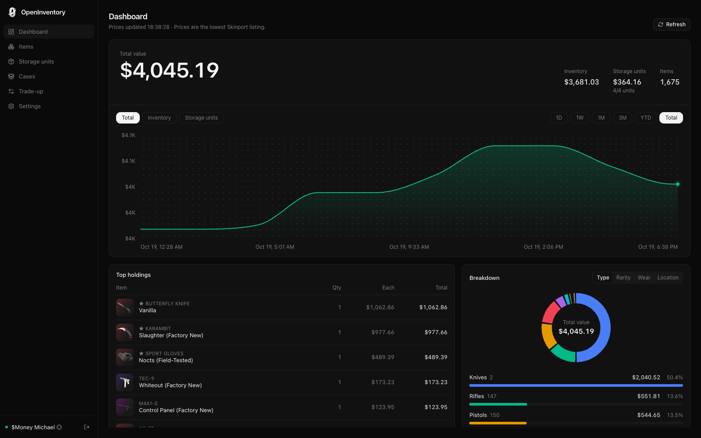
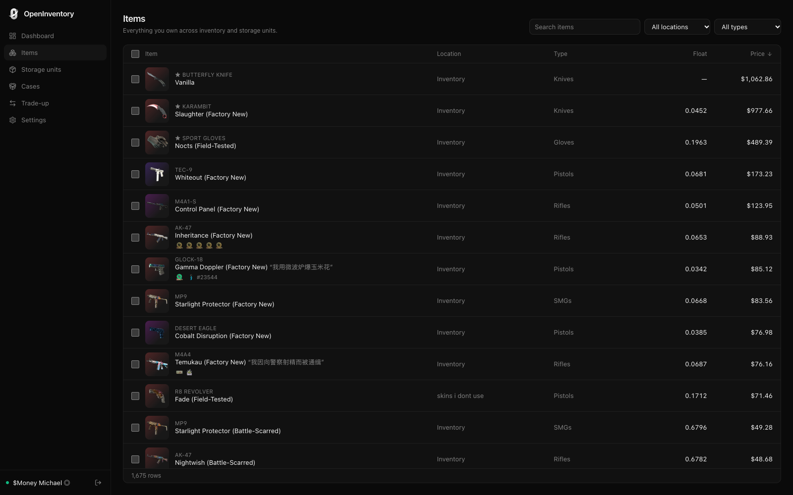
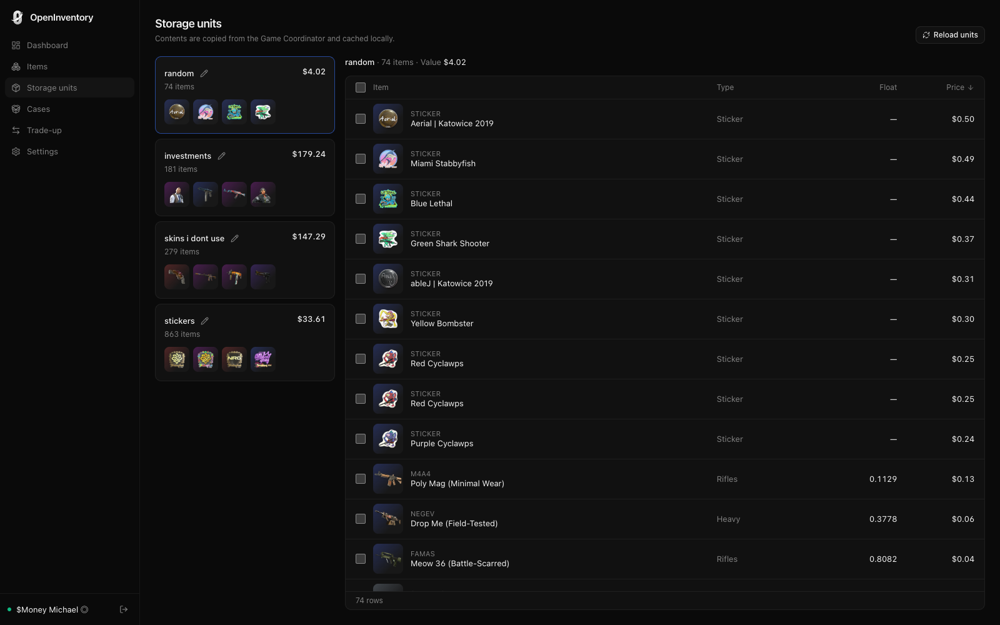
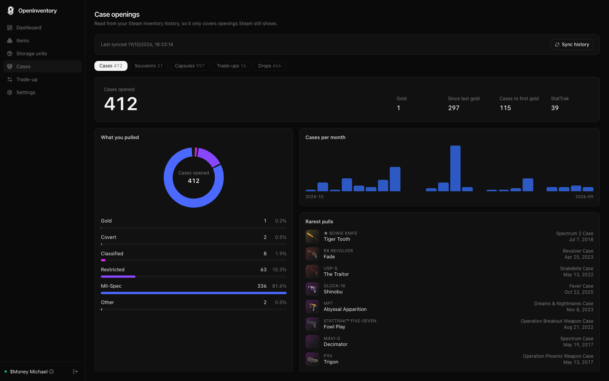
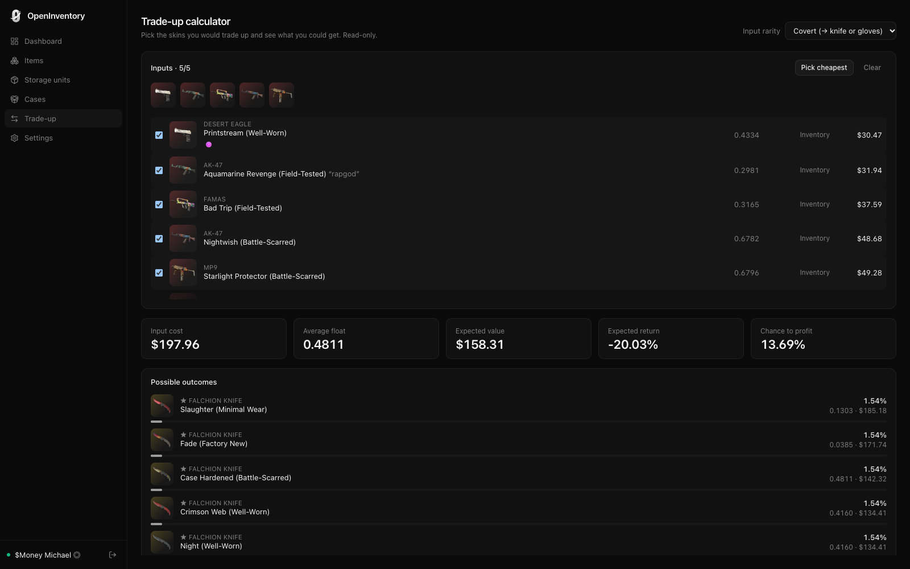

<p align="center">
  
</p>

<h1 align="center">OpenInventory</h1>

<p align="center">Self-hosted CS2 inventory and storage unit tracker. Available for <b>macOS</b>, <b>Windows</b> and <b>Linux</b>.</p>

<p align="center">
  <a href="https://github.com/8liam/OpenInventory/releases/latest"><b>Download the latest release</b></a>
</p>

<table>
  <tr>
    <td align="center"><a href="docs/dashboard.png"></a><br /><sub>Dashboard</sub></td>
    <td align="center"><a href="docs/items.png"></a><br /><sub>Items</sub></td>
    <td align="center"><a href="docs/storage-units.png"></a><br /><sub>Storage units</sub></td>
  </tr>
  <tr>
    <td align="center"><a href="docs/cases.png"></a><br /><sub>Case openings</sub></td>
    <td align="center"><a href="docs/tradeup.png"></a><br /><sub>Trade-up</sub></td>
  </tr>
</table>

Sign in with the Steam mobile app (as many accounts as you like) and OpenInventory shows what you own, where it is and what it's worth, with history that builds up over time. Everything is cached in a local SQLite file on your own machine.

## Features

- **Dashboard**: total value with 24h/7d/30d change, value history, breakdowns by type, rarity, wear and location, top holdings, lowest and highest floats.
- **Items**: everything across your inventory and storage units, searchable and filterable, with floats, stickers, charms and prices.
- **Storage units**: all units load automatically and are cached for instant restarts.
- **Move items** between your inventory and storage units, confirmed by the Game Coordinator with live progress.
- **Cases**: opening stats from your Steam inventory history: rarity split, rarest pulls, gold drought.
- **Trade-up finder**: read-only EV estimates for ranked contracts. It can't perform trade-ups.
- **Terminals**: browse offers, and activate or skip to the next offer behind a confirmation (both are irreversible). It never buys anything.
- **Multiple accounts** with a combined "All accounts" view.
- **Exports** of item data and value history as CSV or JSON.

Apart from moving items, renaming storage units and the Terminal actions above, OpenInventory is read-only. It never lists or trades anything.

## Download

Get the installer for your OS from the [latest release](https://github.com/8liam/OpenInventory/releases/latest):

| OS      | File        |
| ------- | ----------- |
| macOS   | `.dmg`      |
| Windows | `.exe`      |
| Linux   | `.AppImage` |

The app updates itself on Windows and Linux; on macOS it tells you when a new version is out. Builds aren't code-signed, so the first launch warns you: on Windows choose **More info → Run anyway**; on macOS right-click the app and choose **Open** (or run `xattr -cr /Applications/OpenInventory.app`). Releases are built by [GitHub Actions](.github/workflows/release.yml) straight from `main`.

## Run with Docker

```sh
docker compose up -d
```

Open <http://localhost:3000>, press **Show QR code**, and scan it in the Steam mobile app. Data lives in the `openinventory-data` volume.

| Variable                      | Default                                         | Purpose                                                                                                                                              |
| ----------------------------- | ----------------------------------------------- | ---------------------------------------------------------------------------------------------------------------------------------------------------- |
| `OPENINVENTORY_PASSWORD`      | unset                                           | Require HTTP basic auth (any username). Set it if anyone but you can reach the port.                                                                 |
| `OPENINVENTORY_PORT`          | `3000` in Docker, `4174` otherwise              | Listen port.                                                                                                                                         |
| `OPENINVENTORY_HOST`          | `0.0.0.0` in Docker, `127.0.0.1` otherwise      | Listen address.                                                                                                                                      |
| `OPENINVENTORY_DATA_DIR`      | `/data` in Docker, `~/.openinventory` otherwise | SQLite database and Steam sessions.                                                                                                                  |
| `OPENINVENTORY_WEB_DIR`       | set in Docker                                   | Built web app to serve. Unset in dev.                                                                                                                |
| `OPENINVENTORY_ALLOWED_HOSTS` | unset                                           | Extra hostnames accepted when no password is set (`nas.lan,.home.example`; a leading dot matches subdomains). IPs, `localhost`, `*.local`, `*.ts.net` and single-label names always work. |

## Good to know

- **One session per account.** Steam allows one game session per account. If CS2, the Steam app or another OpenInventory is signed in to the same account, they take the session from each other. OpenInventory never forces it: close the other one, then press **Reconnect**.
- **Protect your data.** Your Steam refresh token is stored per account in `sessions/<steamId>.json` (mode `0600`) in the data directory, and anyone who can read it can act as your account until you remove it in Settings. Without a password, anyone who can reach the port can see your inventory **and move your items**, so set one and use a VPN or TLS reverse proxy if you expose it.
- State-changing requests are same-origin only with a JSON body, and unauthenticated instances check the `Host` header against DNS rebinding.

## Develop

Requires Node 24+ and pnpm 12 ([Vite+](https://viteplus.dev) provides `vp`).

```sh
pnpm install
pnpm api          # API on 127.0.0.1:4174
pnpm dev          # web on :5173, proxying /api
pnpm build        # type-check + production build
vp check          # format, lint and type-check
```

Stack: React 19, TanStack Router and Virtual, Tailwind 4, Zustand, Vite+, plain Node with `node:sqlite`, and `steam-session`, `steam-user`, `globaloffensive` for Steam. `src/` and `server/` hold the app; `site/` is the [landing page](https://openinventory.unsurf.sh) ([details](site/README.md)).

## Data sources

- Item names, rarities and images: [ByMykel/CSGO-API](https://github.com/ByMykel/CSGO-API) (images from Steam's CDN).
- Prices: [CSGOTrader](https://prices.csgotrader.app) marketplace feeds (Buff163 by default; Skinport, Steam, CSFloat, CS.MONEY, Youpin898 and LIS-SKINS selectable in Settings). Items with no listing count as zero.
- Value history is recorded hourly while OpenInventory runs, starting from your first sign-in; it can't be backfilled.

OpenInventory is not affiliated with or endorsed by Valve, Steam or Skinport.

## License

[PolyForm Noncommercial 1.0.0](LICENSE): use, modify, fork and share for any noncommercial purpose. Source-available, not OSI open source. For commercial use, open an issue.
