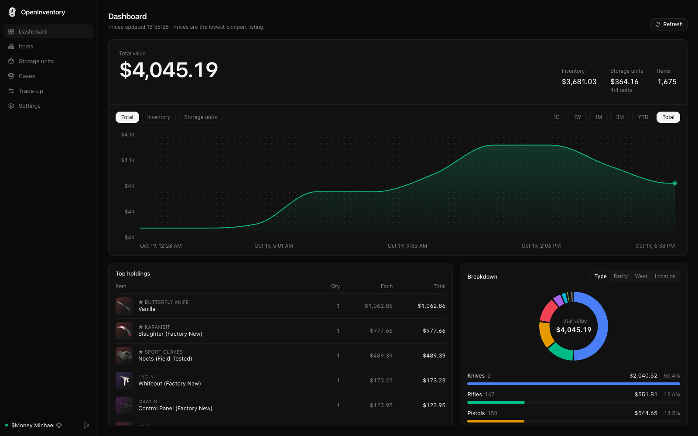
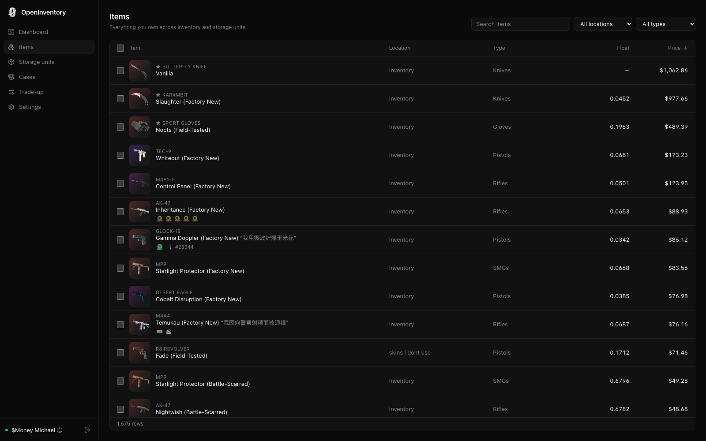
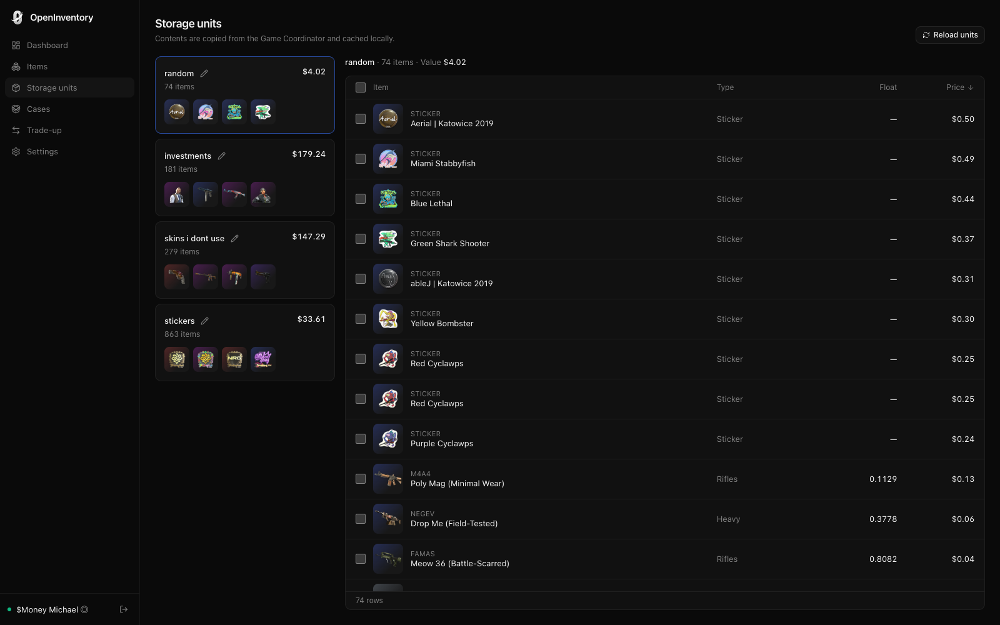
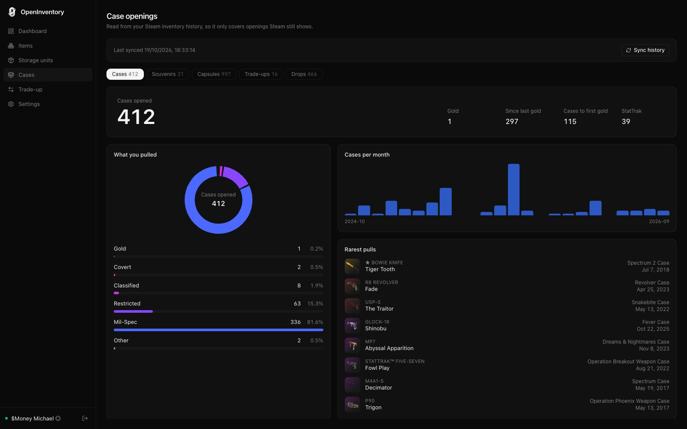
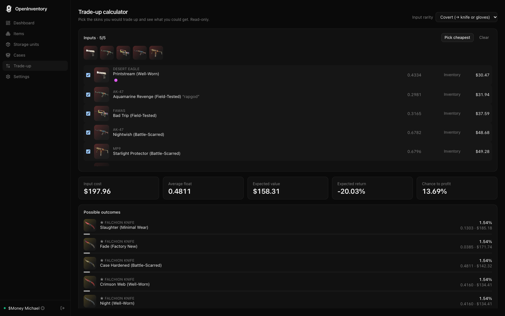

<p align="center">
  
</p>

<h1 align="center">OpenInventory</h1>

<table>
  <tr>
    <td align="center"><a href="docs/dashboard.png"></a><br /><sub>Dashboard</sub></td>
    <td align="center"><a href="docs/items.png"></a><br /><sub>Items</sub></td>
    <td align="center"><a href="docs/storage-units.png"></a><br /><sub>Storage units</sub></td>
  </tr>
  <tr>
    <td align="center"><a href="docs/cases.png"></a><br /><sub>Case openings</sub></td>
    <td align="center"><a href="docs/tradeup.png"></a><br /><sub>Trade-up</sub></td>
  </tr>
</table>

Self-hosted CS2 inventory and storage unit tracker. Sign in once with the Steam mobile app and OpenInventory shows what you own, where it is, and what it's worth, with history that builds up over time. Everything is cached in a local SQLite file on your own server. OpenInventory talks to Steam (with your login), fetches public item data and Skinport prices, and your browser loads item images from Steam's CDN.

- **Dashboard**: total value with 24h/7d/30d change, a value history chart you can switch between total, inventory and storage units over 1D to all time, a tabbed breakdown (type, rarity, wear, location) as a donut, top holdings, and your lowest floats, highest floats and largest stacks.
- **Items**: every item across your inventory and all storage units, searchable and filterable, with images, floats, stickers, charms (with pattern ids) and prices.
- **Storage units**: all units load automatically; contents are cached so restarts are instant. Capacity (1,000 items) is checked before a move starts.
- **Cases**: case, souvenir, capsule, trade-up and drop stats read from your Steam inventory history: rarity split, rarest pulls, most opened, per-month volume, and your gold drought. History is synced in the background and stored locally.
- **Trade-up calculator**: read-only estimate of expected value from your cheapest tradable skins and their collections. OpenInventory can't perform trade-ups.

- **Move items**: select items on the Items or Storage page and move them between your inventory and storage units (unit to unit goes through your inventory). Each move is confirmed by the Game Coordinator, with live progress, cancel, and a per-item error report. Nothing is ever listed or traded.

## Run with Docker

```sh
docker compose up -d
```

Open <http://localhost:3000>, press **Show QR code**, and scan it in the Steam mobile app.

Set a password if the port is reachable by anyone but you (the browser will ask for any username plus this password):

```sh
OPENINVENTORY_PASSWORD='something-long' docker compose up -d
```

Data (SQLite database, value history and your Steam session) lives in the `openinventory-data` volume.

> **Heads up:** OpenInventory connects to the CS2 Game Coordinator the way the game does, and Steam allows one game session per account. If CS2 is already running elsewhere, OpenInventory waits (it never forces the session) and connects when you close the game. If you launch CS2 while OpenInventory is connected, Steam asks whether to end OpenInventory's session; it reconnects once you're done.

### Configuration

| Variable                 | Default                                         | Purpose                                                      |
| ------------------------ | ----------------------------------------------- | ------------------------------------------------------------ |
| `OPENINVENTORY_PASSWORD` | unset                                           | Require HTTP basic auth (any username). Unset means no auth. |
| `OPENINVENTORY_PORT`     | `3000` in Docker, `4174` otherwise              | Listen port.                                                 |
| `OPENINVENTORY_HOST`     | `0.0.0.0` in Docker, `127.0.0.1` otherwise      | Listen address.                                              |
| `OPENINVENTORY_DATA_DIR` | `/data` in Docker, `~/.openinventory` otherwise | SQLite database and Steam session.                           |
| `OPENINVENTORY_WEB_DIR`  | set in Docker                                   | Built web app to serve. Unset in dev.                        |

## Security

- Your Steam **refresh token** is stored in `session.json` inside the data directory (mode `0600`). Anyone who can read it can act as your account until you press **Sign out**, which deletes it. Protect the volume.
- Without `OPENINVENTORY_PASSWORD`, anyone who can reach the port can see your inventory **and move your items**. Set a password, and put OpenInventory behind a VPN or a TLS reverse proxy if you expose it.
- State-changing requests are same-origin only and require a JSON body, so another website can't drive your instance from your browser.

## Develop

Requires Node 24+ and pnpm 12 ([Vite+](https://viteplus.dev) provides `vp`).

```sh
pnpm install
pnpm api          # API on 127.0.0.1:4174 (SQLite in ~/.openinventory)
pnpm dev          # web on :5173, proxying /api
pnpm build        # type-check + production build into dist/
vp check          # format, lint and type-check
```

Stack: React 19, TanStack Router and Virtual, Tailwind 4, Zustand, Vite+. The server is plain Node with the built-in `node:sqlite`; Steam access uses `steam-session`, `steam-user` and `globaloffensive`.

## Data sources

- Item names, rarities and images: [ByMykel/CSGO-API](https://github.com/ByMykel/CSGO-API) (images are served from Steam's CDN).
- Prices: [CSGOTrader](https://prices.csgotrader.app) marketplace feeds (Buff163 by default; Skinport, Steam, CSFloat, CS.MONEY, Youpin898 and LIS-SKINS selectable in Settings), converted with its exchange rates. Items with no listing count as zero.
- Value history is recorded hourly while OpenInventory runs, for every currency you've viewed the dashboard in, starting from your first sign-in; there is no way to backfill it.

OpenInventory is not affiliated with or endorsed by Valve, Steam or Skinport.
